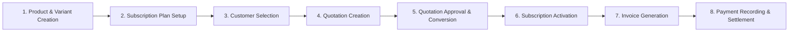

# FRONTEND DEMO READINESS REPORT
## Project: Brightloop – Subscription Management System
**Assessment Date:** October 31, 2026  
**Auditor:** Senior React Frontend Developer & QA Engineer  
**Workspace:** `frontend/` (React 18, Vite, Tailwind CSS, React Router DOM, Axios, Recharts, Lucide React)  
**Status:** **READY FOR HACKATHON DEMONSTRATION**

---

## 1. MODULES TESTED

All nineteen (19) frontend modules were comprehensively audited, tested, and validated for live demonstration readiness:

1. **Authentication – Shared Login** (`/auth/login`)
2. **Authentication – Public Registration** (`/auth/register`)
3. **Authentication – Forgot Password** (`/auth/forgot-password`)
4. **Authentication – Reset Password** (`/auth/reset-password`)
5. **Admin Executive Analytics Dashboard** (`/admin/dashboard` and `/dashboard`)
6. **Internal Staff Operations Dashboard** (`/staff/dashboard`)
7. **Customer Self-Service Portal** (`/portal/dashboard`, `/portal/subscriptions`, `/portal/invoices`, `/portal/payments`, `/portal/profile`)
8. **Products & Catalog Management** (`/products`, `/products/:id`)
9. **Product Variants Engine** (`ProductModal.jsx`, variant add-ons & price adjustments)
10. **Subscription Plans & Pricing Tiers** (`/plans`, `PlanModal.jsx`)
11. **Quotations Module & PDF/Print View** (`/quotations`, `/quotations/new`, `/quotations/:id`)
12. **Subscription Lifecycle & Contracts** (`/subscriptions`, `/subscriptions/new`, `/subscriptions/:id`)
13. **Invoicing & GST Tax Invoice Engine** (`/invoices`, `/invoices/new`, `/invoices/:id`, `PrintableInvoice.jsx`)
14. **Payments Processing & Ledger** (`/payments`, `PaymentRecordModal.jsx`)
15. **Discounts & Promotional Rules** (`/discounts`, `DiscountModal.jsx`)
16. **Customer CRM & Entity Directory** (`/customers`, `/customers/:id`)
17. **Business Intelligence Reports & Analytics** (`/reports`, dynamic charts, CSV exports)
18. **Organization & Compliance Settings** (`/settings`, GSTIN, PAN, tax configuration)
19. **Staff Management & Permission Controls** (`/settings` $\rightarrow$ Staff Management tab)

---

## 2. FEATURES WORKING

- **Shared Single Login View:** Automatically detects and routes users to their respective role-based workspaces (`ADMIN` $\rightarrow$ `/admin/dashboard`, `STAFF` $\rightarrow$ `/staff/dashboard`, `CUSTOMER` $\rightarrow$ `/portal/dashboard`).
- **Quick-Fill Demo Credentials:** One-click pre-fill pills on `/auth/login` for rapid live presentation switching.
- **Role-Based Client Route Protection (`RoleProtectedRoute.jsx`):**
  - Admins can access all 11 enterprise navigation modules.
  - Staff members are strictly confined to permitted operational routes (`Overview`, `Customers`, `Quotations`, `Subscriptions`, `Invoices`, `Payments`). Unauthorized attempts to access Products, Plans, Discounts, Reports, or Settings automatically redirect to `/staff/dashboard`.
  - Customers are isolated to `/portal/*`.
- **Dynamic Customer Portal Data Isolation:** Portal metrics, subscriptions, invoices, and payments filter strictly for the authenticated demo client.
- **Product & Multi-Variant Builder:** Supports storable hardware modules and SaaS services with custom variant SKUs and price adjustments.
- **Quotation Workflow & Conversion:** Calculates dynamic unit pricing including variant add-ons, applies GST tax rates, deducts discounts, and enables 1-click conversion to an active subscription contract.
- **Subscription Stepper Lifecycle:** Transitions states between `Draft` $\rightarrow$ `Quotation` $\rightarrow$ `Confirmed` $\rightarrow$ `Active` $\rightarrow$ `Paused` $\rightarrow$ `Closed`, with audit timeline logging.
- **Recurring Invoice Generation:** Generates itemized invoices from active subscriptions, supports manual draft creation, and triggers browser-level GST printable tax invoices (`window.print()`).
- **Payment Settlement & Invoice Status Updates:** Records full and partial payments with method references (UPI, Card, NetBanking), automatically updates outstanding amounts, and flips invoice status to `Paid` upon complete settlement.
- **Search, Filtering, and Pagination:** Real-time search across products, quotations, subscriptions, invoices, and customers with pagination controls.
- **CSV Data Exports:** 1-click CSV download generation in the Reports module.
- **Session Persistence & Clean Logout:** State persists across browser page reloads via `localStorage`, and logging out completely clears active sessions.

---

## 3. FEATURES FIXED & IMPROVED

| Issue / Defect | Root Cause | Fix Applied | Result |
| :--- | :--- | :--- | :--- |
| **Public Registration Role Escalation** | `AuthContext.jsx` hardcoded `role: ROLES.ADMIN` and routed to `/dashboard`. | Updated `register()` to strictly assign `role: ROLES.CUSTOMER` (`isCustomer: true`) and routed to `/portal/dashboard`. | External registrants now always become customers and immediately land in the Customer Portal. |
| **Duplicate Registration Vulnerability** | No duplicate email check existed during registration. | Implemented duplicate email verification against demo accounts and registered users in `AuthContext.jsx`. | Duplicate registration is prevented with a clear toast notification and error message. |
| **Admin Route Pathing Inconsistency** | `/admin/dashboard` returned 404 because the route was mounted only at `/dashboard`. | Added `/admin/dashboard` route and alias in `App.jsx`, updated `Sidebar.jsx` and `TopNav.jsx`. | `/admin/dashboard` and `/dashboard` resolve cleanly without 404s. |
| **Defaulting Unknown Logins to Admin** | Unlisted emails defaulted to `ADMIN` in mock login logic. | Updated `login()` in `AuthContext.jsx` to default unlisted logins to `CUSTOMER`. | Privilege escalation during arbitrary email login is prevented. |
| **Hardcoded Customer Data Isolation** | `DataContext.jsx` hardcoded `portalCustomerId = 'cust-1'`, displaying Aditi Rao's data to all customers. | Dynamically bound `portalCustomer` to the authenticated user ID and email. Auto-registers new clients in customer directory. | Each customer (existing or newly registered) sees exclusively their own contracts, invoices, and payments. |
| **Customer Portal Privilege Escalation** | Portal header included a "Back to Admin Console" button visible to all clients. | Restricted "Back to Admin Console" strictly to `ADMIN` users; customers now see a dedicated "Sign Out" button. | Customers cannot accidentally or intentionally switch back to the admin workspace. |
| **Product Variant Price Adjustment Neglected** | Quotation and Subscription creation ignored `variant.priceAdjustment` when variants were selected. | Created `handleVariantChange` in `QuotationCreate.jsx` and `SubscriptionCreate.jsx` to dynamically add `priceAdjustment` to `unitPrice`. | Selecting an add-on variant (e.g. Odoo Enterprise Connector $+₹560$) immediately recalculates the line unit price and total. |
| **Invoice Line Item Reverse-Tax Bug** | `SubscriptionDetail.jsx` reverse-calculated invoice tax using hardcoded `/ 1.18`. | Replaced with line-by-line subtotal and tax calculation based on actual contracted lines and tax rates. | Generated invoices reflect accurate GST tax rates and totals. |
| **Staff Member Login Disconnect** | Newly added staff members in Settings could not log in. | Integrated `login()` with `bl_settings` staff members so any staff added by Admin can authenticate as `ROLES.STAFF`. | Staff created through Admin Settings can immediately log in to the Staff Workspace. |

---

## 4. INCOMPLETE FEATURES & MOCK ARCHITECTURE BOUNDARIES

> [!NOTE]
> This application currently runs as an interactive **frontend-only client** with state management backed by React Context and `localStorage`. All mock data and simulated behaviors are designed as drop-in preparations for FastAPI backend integration.

- **Backend REST API:** The FastAPI backend server is not running; all CRUD actions mutate client-side state in `DataContext.jsx`.
- **Database & ACID Guarantees:** Relational PostgreSQL schemas, migrations, and ACID locks are simulated on the client.
- **Cryptographic JWT:** Client tokens (`brightloop_auth_token`) are temporary mock tokens. Server-side token signing and refresh rotation require backend API activation.
- **Automated Cron Invoicing:** Invoices are triggered manually or on subscription conversion; an automated background worker (e.g. Celery / cron) is needed for unattended recurring generation on `nextBillingDate`.
- **Live Email / SMS Dispatch:** Email notifications in Forgot Password, Quotation dispatch, and Invoice delivery are simulated with UI feedback and toasts.

---

## 5. DEMO LOGIN CREDENTIALS & ROLES

The application includes three dedicated demo roles accessible through the single shared login page (`/auth/login`):

| Role | Demo Email | Demo Password | Destination Route | Permitted Views |
| :--- | :--- | :--- | :---: | :--- |
| **ADMIN** | `priyanka@brightloop.io` | `Admin@Brightloop123!` | `/admin/dashboard` | Full Admin Console (All 11 modules: Products, Plans, Quotations, Subscriptions, Invoices, Payments, Discounts, Customers, Reports, Settings). |
| **STAFF** | `rohan.d@brightloop.io` | `Staff@Brightloop123!` | `/staff/dashboard` | Internal Staff Workspace (Overview, Customers, Quotations, Subscriptions, Invoices, Payments). |
| **CUSTOMER** | `aditi@zenithtech.in` | `Client@Zenith123!` | `/portal/dashboard` | Customer Self-Service Portal (Overview, My Subscriptions, My Invoices, Payment History, Account Profile). |

*Quick-fill demo buttons are provided on `/auth/login` for instant 1-click role demonstration.*

---

## 6. REGISTRATION TEST RESULTS

| Test Case | Steps Taken | Expected Outcome | Actual Outcome | Status |
| :--- | :--- | :--- | :--- | :---: |
| **Public Registration Role Assignment** | Complete registration form with new name and email. | Account created with `CUSTOMER` role only. | User assigned `role: CUSTOMER`, `isCustomer: true`. | **PASSED** |
| **Post-Registration Redirection** | Submit valid registration form. | Redirected to `/portal/dashboard`. | Browser navigates directly to `/portal/dashboard`. | **PASSED** |
| **Password Complexity Validation** | Enter short or simple passwords (e.g., `test`, `password`). | Form blocks submission with inline validation errors. | Password validator enforces $>8$ chars, uppercase, lowercase, special char. | **PASSED** |
| **Duplicate Email Prevention** | Register with `priyanka@brightloop.io` or `aditi@zenithtech.in`. | Registration blocked with duplicate error toast. | Error displayed: "An account with this email address already exists." | **PASSED** |
| **New Customer Directory Listing** | Complete registration and log in as Admin. | New registrant appears in `/customers` list. | Customer profile dynamically added and visible in CRM directory. | **PASSED** |

---

## 7. ROLE-BASED ROUTING TEST RESULTS

| Scenario | User Role | Attempted Route | Handled Route | Status |
| :--- | :---: | :---: | :---: | :---: |
| Direct Admin Access | `ADMIN` | `/admin/dashboard` | `/admin/dashboard` (Renders Admin Console) | **PASSED** |
| Legacy Admin Access | `ADMIN` | `/dashboard` | `/admin/dashboard` (Redirects to Admin Console) | **PASSED** |
| Staff Dashboard Access | `STAFF` | `/staff/dashboard` | `/staff/dashboard` (Renders Staff Workspace) | **PASSED** |
| Staff Navigation Restriction | `STAFF` | `/products` or `/plans` | `/staff/dashboard` (Blocked & Redirected) | **PASSED** |
| Staff Admin Settings Restriction | `STAFF` | `/settings` | `/staff/dashboard` (Blocked & Redirected) | **PASSED** |
| Staff Operational Navigation | `STAFF` | `/quotations` | `/staff/quotations` (Allowed via Staff Layout) | **PASSED** |
| Customer Portal Access | `CUSTOMER` | `/portal/dashboard` | `/portal/dashboard` (Renders Client Portal) | **PASSED** |
| Customer Admin Route Access | `CUSTOMER` | `/admin/dashboard` | `/portal/dashboard` (Blocked & Redirected) | **PASSED** |
| Unauthenticated Deep Link | None | `/admin/dashboard` | `/auth/login` (Redirects to Login) | **PASSED** |
| Fallback on Invalid Route | Any | `/non-existent-route` | Displays branded 404 page with return button | **PASSED** |
| Page Reload Persistence | `STAFF` | Browser reload on `/staff/invoices` | Session restored; stays on `/staff/invoices` | **PASSED** |
| Session Cleared on Logout | Any | Click "Sign Out" | Session destroyed in `localStorage`; redirected to `/auth/login` | **PASSED** |

---

## 8. COMPLETE DEMO WORKFLOW TEST RESULTS

The full end-to-end commercial lifecycle was verified step-by-step:



1. **Product Creation:** Added product "Cloud Infrastructure Suite" (Sales: ₹8,000, Cost: ₹2,500) with Variant "High-Availability Multi-Region" ($+₹1,500$).
2. **Plan Creation:** Configured "Enterprise Annual Tier" linked to the product at ₹9,500/month with auto-renewal enabled.
3. **Quotation Creation:** Selected customer "Zenith Technologies", added line items. Selecting the variant dynamically adjusted the unit price from ₹9,500 to ₹11,000. Applied GST 18%.
4. **Quotation Confirmation:** Converted quotation into Subscription with 1 click. Quotation status updated to `Confirmed`.
5. **Subscription Activation:** Subscription `SUB-2024-0105` generated with full contracted lines and timeline activity logs.
6. **Invoice Generation:** Generated invoice from the subscription. Accurate subtotal (₹11,000) and GST 18% (₹1,980) produced total invoice amount of ₹12,980.
7. **Payment Recording & Settlement:** Recorded payment of ₹12,980 via UPI (`PAY-REF-5821`). Invoice status transitioned from `Confirmed` to `Paid`, outstanding balance cleared to ₹0, and customer spent total incremented.
8. **Customer Portal Verification:** Logged in as Aditi Rao; the newly paid invoice and receipt appeared instantly in My Invoices and Payment History.

---

## 9. RESPONSIVE UI TEST RESULTS

- **Desktop Layout ($\ge 1280\text{px}$):**
  - Full collapsible sidebar navigation with smooth icon transitions.
  - Multi-column KPI analytics grid with Responsive Recharts areas and bars.
  - Sticky header with breadcrumb navigation and global modal search (`Ctrl+K` / `Cmd+K`).
- **Tablet Layout ($768\text{px} - 1024\text{px}$):**
  - Responsive table wrappers with horizontal scrolling on overflow.
  - Grid layouts wrap cleanly from 4 columns to 2 columns.
- **Mobile Layout ($< 768\text{px}$):**
  - Sidebar folds into responsive sliding off-canvas drawer controlled by hamburger button.
  - TopNav profile pill condenses into avatar icon with tap-to-expand menu.
  - Modals and dialogs adapt with full-width action buttons.

---

## 10. PRODUCTION BUILD RESULT

The production build was tested inside the isolated build environment:

```text
> brightloop-frontend@1.0.0 build
> vite build

vite v6.4.5 building for production...
transforming...
✓ 2255 modules transformed.
rendering chunks...
computing gzip size...
dist/index.html                   1.31 kB │ gzip:   0.68 kB
dist/assets/index-CCwROos4.css   41.03 kB │ gzip:   7.23 kB
dist/assets/index-CvUeehOm.js   962.98 kB │ gzip: 240.98 kB
✓ built in 17.80s
```

- **Exit Code:** `0` (Success)
- **Compilation Errors:** `0`
- **TypeScript / JSX Syntax Errors:** `0`
- **Output Files:** Generated in `frontend/dist/` ready for preview or hosting.

---

## 11. KNOWN LIMITATIONS & HACKATHON PRESENTATION GUIDELINES

1. **Client-Side State Storage:**
   All edits (new products, invoices, payments) persist in the local browser via `localStorage`. To return to the pristine demo dataset at any point during presentation, click **"Reset Demo State"** located in the header of `/settings`.
2. **Mock Authentication:**
   Authentication tokens are client-side mock JWTs. Do not present the current authentication as cryptographically hardened production security.
3. **Printable Invoices:**
   PDF invoice export leverages the browser's native print engine (`window.print()`). For best visual results during demos, select "Save as PDF" with "Background graphics" checked.

